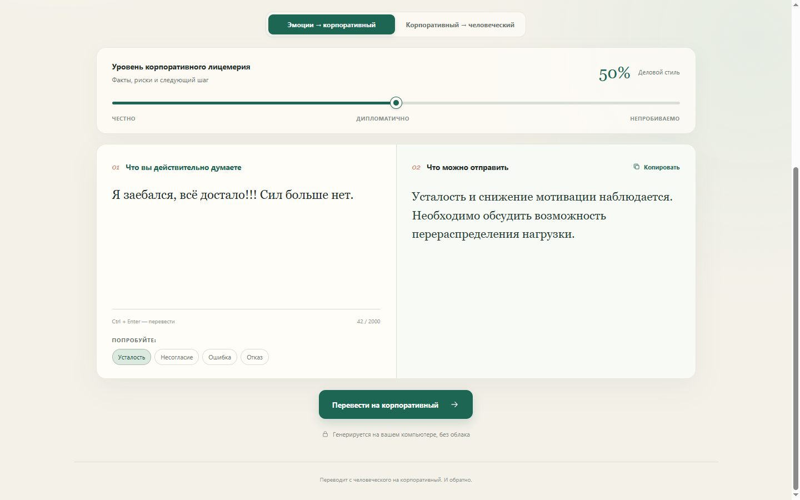
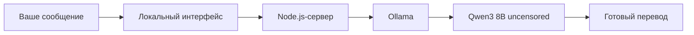

<div align="center">

# Этикет

### Переводит с человеческого на корпоративный. И обратно.

**Локальный AI-редактор, который превращает мат, усталость и раздражение в безупречную деловую речь — а корпоративный канцелярит возвращает обратно в человеческий язык.**

<p>
  
  
  
  
</p>

[Почему это нужно](#почему-это-нужно) · [Возможности](#возможности) · [Быстрый старт](#быстрый-старт) · [Как это работает](#как-это-работает)



</div>

## Почему это нужно

Одна и та же мысль может звучать как **«Я заебался, сил больше нет»** или как **«Наблюдаю снижение личного ресурса и предлагаю пересмотреть нагрузку»**. Разница — не в смысле, а в коде коммуникации.

**Этикет переводит с одного кода на другой.** Он помогает отправить то, что вы действительно имеете в виду, не превращая рабочий разговор в конфликт. А если коллега прислал три абзаца про синергию и вовлечённость — помогает понять, что он вообще хотел сказать.

Это не словарь и не набор заранее заготовленных ответов. Каждый результат генерирует языковая модель с учётом исходного сообщения, направления и выбранной интенсивности стиля.

## Возможности

- **Два направления перевода:** эмоции → корпоративный и корпоративный → человеческий.
- **Шкала 0–100%:** от прямой уважительной речи до максимальной корпоративной витиеватости. В обратную сторону — от спокойного разговора до речи без цензуры.
- **Генерация через LLM:** модель переписывает смысл, а не заменяет отдельные слова.
- **Внимание к контексту:** модель старается сохранить имена, проекты, сроки, числа и намерение автора.
- **Удобный обратный перевод:** при смене направления готовый результат подставляется как исходный текст.
- **Полная локальность:** сообщения обрабатываются на вашем компьютере, без облака, аккаунтов и API-ключей.
- **Запуск одной кнопкой:** `START.bat` поднимает Ollama, локальный сервер и открывает браузер.
- **Адаптивный интерфейс:** аккуратно выглядит как на широком мониторе, так и на узком экране.

## Быстрый старт

### Что понадобится

- Windows 10 или 11;
- [Node.js 18+](https://nodejs.org/);
- [Ollama](https://ollama.com/);
- около 5 ГБ свободного места для модели.

### Установка

```bash
git clone https://github.com/vitorli/etiket.git
cd etiket
ollama pull huihui_ai/qwen3-abliterated:8b
```

Теперь дважды щёлкните по **`START.bat`**. Больше ничего запускать не нужно: приложение само откроется по адресу [http://127.0.0.1:3000](http://127.0.0.1:3000).

Если Ollama уже запущена, можно использовать терминал:

```bash
npm start
```

Устанавливать npm-зависимости не требуется — их у проекта нет.

## Настройка стиля

| Значение | В корпоративный | В человеческий |
| --- | --- | --- |
| **0–20%** | Прямо и уважительно | Прямо и спокойно, без мата |
| **21–40%** | Мягко и по делу | Простой разговорный стиль |
| **41–60%** | Конкретный деловой стиль | Эмоционально и разговорно |
| **61–80%** | Завуалированный корпоративный | Жёстко, грубо, с матом |
| **81–100%** | Максимальное корпоративное лицемерие | Максимально эмоционально, без цензуры |

Ползунок можно двигать после перевода: приложение автоматически создаст новый вариант. Для запуска генерации также работает **Ctrl + Enter**.

## Как это работает



Браузер общается только с локальным Node.js-сервером. Сервер передаёт текст в локальный Ollama Chat API и возвращает сгенерированный результат. Приложение слушает только `127.0.0.1`: аналитика, телеметрия и внешние AI-сервисы не используются.

### Технологии

- **Интерфейс:** HTML, CSS, современный JavaScript;
- **Сервер:** встроенные модули Node.js;
- **Генерация:** Ollama + `huihui_ai/qwen3-abliterated:8b`;
- **Зависимости:** ноль npm-пакетов.

## Важно

LLM генерирует новый текст, поэтому результат стоит читать перед отправкой. Модель может изменить оттенок смысла или ошибиться в деталях — особенно на максимально витиеватых и максимально грубых уровнях. Для ответственной переписки финальное решение всегда остаётся за человеком.

---

<div align="center">

**Этикет — потому что иногда между «всё заебало» и «предлагаю оптимизировать процесс» нужен всего один переводчик.**

</div>
